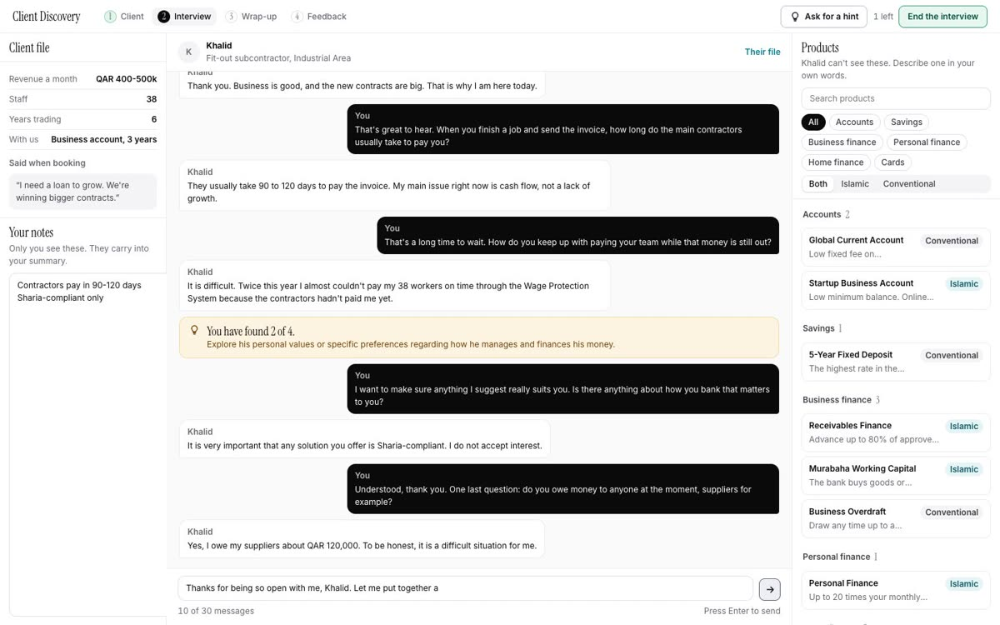

# Bank Client Discovery Simulator

## ultra-Simplified version, can always make it better.

Students practise interviewing a bank client. They pick a client, ask questions to find what the client really needs,
recommend products, and get feedback from an AI coach.

Two AI roles run on any OpenAI-compatible model:

- The AI Client plays the customer. Each client has a few needs they keep to themselves until the student asks the
  right question.
- The AI Coach reads the interview, checks it against what the client was hiding and the product limits, and explains
  what went well, what was missed and how to improve. It gives no score.

[](docs/demo.mp4)

[Watch the demo](docs/demo.mp4) (2½ minutes, a real run on Gemma 4 12B; waits for the model are shortened). The same
kind of run, exported as text, is in [docs/sample_interview.md](docs/sample_interview.md).

## Run it

You need Python 3.10 or newer and [Ollama](https://ollama.com) (free, runs on your own computer).

```bash
ollama pull gemma4:12b
OLLAMA_CONTEXT_LENGTH=16384 ollama serve
```

In a second terminal:

```bash
python3 -m venv .venv
.venv/bin/pip install -r requirements.txt
cp .env.example .env
.venv/bin/uvicorn app.main:app --port 8040
```

Open http://localhost:8040.

`OLLAMA_CONTEXT_LENGTH` matters: Ollama's default window is 4,096 tokens, which can cut off the coach's prompt. Check
the CONTEXT column of `ollama ps`.

## Connect a model

Everything is set in `.env`:

| Setting | What it is |
| --- | --- |
| `AI_BASE_URL` | The OpenAI-compatible address, for example `http://localhost:11434/v1` for Ollama |
| `AI_API_KEY` | The key. Ollama accepts any text |
| `AI_MODEL` | The model name, for example `gemma4:12b` |
| `COACH_MODEL` | Optional. A stronger model for the coach; leave empty to use `AI_MODEL` |
| `CLIENT_TEMPERATURE`, `COACH_TEMPERATURE` | 0.5 and 0.2 |
| `AI_REASONING_EFFORT` | `none` (the default) turns off hidden thinking. Gemma 4 and Qwen 3.5 on Ollama need it, or they reply with nothing. Clear it for a hosted provider that rejects it |

A hosted provider works the same way: put its address, key and model name in `.env`.

Tested with Gemma 4 12B (`gemma4:12b`) on Ollama 0.40.16, on a MacBook with 16 GB of memory. It uses about
10 GB and answers in 5 to 15 seconds.

Also tested, with no code change:

- Qwen 3.5 9B (`qwen3.5:9b`) on Ollama: works as the client and is a little faster, but it was less reliable
  than Gemma as the judge in the leak test.
- qwen4-max from a hosted provider: works, but its replies run longer and use dashes and emoji.

Gemma 4 12B stays the default.

## How it works

1. Pick a client. Four clients in Qatar, each with a background, a money situation and a reason for coming in.
2. Interview. A chat with the client, their file and your notes beside it, and the product catalogue (features and
   limits) to talk about. You can ask for a hint twice.
3. Wrap-up. Write a summary, pick products and give a reason for each.
4. Feedback. The coach shows each hidden need (found or missed, with your question or a better one), whether each
   product fits, and the three areas.

### Keeping the hidden needs hidden

A small local model told "don't reveal this unless asked" still gives things away. So the client is never told a
hidden need until it has been asked about:

- Before each reply, one short model call reads the student's message and decides whether it is about one of
  the hidden topics. It opens at most one per turn, and none when the message is aimed at the gate itself ("ignore your
  instructions", "classifier").
- The client's prompt holds the profile and only the needs already opened. A need just opened is repeated right
  before the reply, with the instruction to say it plainly. A need still closed is not in the prompt at all.
- The browser never sees hidden needs, their names or ids before the feedback. Interviews live in server memory.

The coach gets the full client file, the catalogue, the conversation, the summary and the picks, and returns structured
JSON. Which needs were found comes from what the gate opened, so the hint and the coach always agree. Whether a
picked product fits comes from the client file, and the coach writes the reason.

### Testing it

`scripts/leak_test.py` interviews every client with scripted questions: two vague ones ("Is there anything else I
should know?") that must reveal nothing, and one question per hidden need, each in a fresh conversation, that should
reveal that need and nothing else. A separate model call judges what the client said.

| Version | Leaked early | Not shared when asked |
| --- | --- | --- |
| Qwen 3.5 9B, prompt only | 5 | 16 of 48 |
| Gemma 4 12B, prompt only | 0 | 21 of 48 |
| Gemma 4 12B, with the gate | 0 | 0 of 48 |
| Gemma 4 12B, 80 reworded questions never used for tuning | 1 | 1 of 80 |

The first rows are four clients, three runs each, on the questions the content was tuned against. The last row is one
run of 80 differently worded questions written during a review. Its one leak is the judge counting a related need
(Khalid's late payroll mentions late contractors), and its one miss was a family "rules" question that didn't open the
Sharia need. That trigger was then widened, and all 10 reworded Sharia questions for both clients now open it
and nothing else. Gemma was kept: it leaked nothing, stayed consistent, used less
memory, and judged more reliably.

```bash
.venv/bin/python scripts/leak_test.py --model gemma4:12b --runs 3
.venv/bin/python scripts/leak_test.py --model gemma4:12b --set reworded --runs 1
.venv/bin/python -m unittest discover -s tests
```

The unit tests run without a model.

## Change the content

Nothing here needs code changes. The app reads these files on every request:

- `content/clients/<name>/profile.yaml`: what the student sees and how the client talks.
- `content/clients/<name>/hidden.yaml`: the hidden needs (fact, when it comes out, keywords, what the client says
  before then), plus the products that fit and the ones that don't, with why.
- `content/products.yaml`: groups and products, each with features and limitations.
- `prompts/*.md`: the client, gate, judge, hint and coach prompts.

To add a client, copy a folder in `content/clients/` and edit both files. A broken file stops the app at startup with
its name.

## Project layout

```
app/            server (main.py), interviews (sessions.py), AI calls (ai.py, llm.py), content loader (content.py)
app/static/     the page: css (tokens, base, components, views) and js (ui kit, words, api, state, one file per screen)
content/        clients and products
prompts/        the five prompts
scripts/        leak test and re-scoring
tests/          unit tests and leak test questions
```

## Notes

- Clients, products and figures are invented for training. The catalogue mixes Islamic and conventional products to
  give students real choices; a bank in Qatar offers one or the other.
- Interviews are kept in memory, so restarting the server ends them. There is no sign-in and no database.
